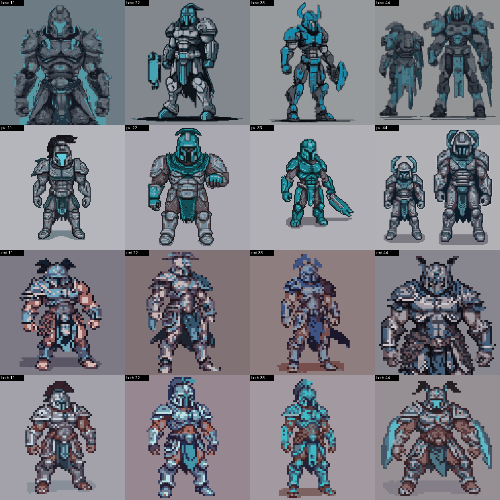

# OpenPixel AI Studio

Plataforma **open source** para criar **personagens, assets isolados, tilesets e mapas completos em pixel art 2D** com IA local. Gera uma imagem com um modelo de difusão (SDXL + LoRAs de pixel art), converte em pixel art de verdade (grade fixa, paleta limitada) e entrega pronta para engines como Godot e Unity.

> O projeto roda **sem GPU** (modo simulado, para desenvolver e testar) e **com GPU** (SDXL localmente ou via ComfyUI). A IA é trocável: você pode usar o modelo, a LoRA ou o serviço que quiser (veja [Usando a IA que você quiser](#usando-a-ia-que-você-quiser)).



*Mesmas seeds e prompt. De cima para baixo: SDXL base, `pixel-art-xl`, `PixelArtRedmond-Lite64` e as duas LoRAs empilhadas.*

---

## Sumário

- [Recursos](#recursos)
- [Arquitetura](#arquitetura)
- [Requisitos](#requisitos)
- [Instalação](#instalação)
- [Como rodar](#como-rodar)
- [Usando a IA que você quiser](#usando-a-ia-que-você-quiser)
- [Configuração](#configuração)
- [Testes](#testes)
- [Estrutura do repositório](#estrutura-do-repositório)
- [Dataset e privacidade](#dataset-e-privacidade)
- [Resultados dos experimentos](#resultados-dos-experimentos)
- [Roadmap](#roadmap)
- [Licenças e créditos](#licenças-e-créditos)

---

## Recursos

- **Geração de sprites** em 16–128 px, com paleta limitada e pixels alinhados à grade.
- **8 direções** de um personagem e **animação** de assets.
- **Animação de corrida com IA** (ComfyUI): poses por ControlNet OpenPose, personagem consistente por IP-Adapter, paleta única, fundo transparente e alinhamento pelos pés. Veja [Animação de corrida e editor de frames](#animação-de-corrida-e-editor-de-frames).
- **Editor de poses** (animação personalizada): arraste o esqueleto frame a frame e envie as poses para a IA gerar o movimento.
- **Editor de frames** na interface: frame a frame, com lápis, borracha, linha, formas, balde, conta-gotas, mover, **varinha de remover fundo** (por cor, com tolerância, em um frame ou em todos), *onion skin*, desfazer/refazer, reprodução e exportação (GIF, folha de sprites, PNG).
- **Fatores de geração editáveis** (⚙ Configurações → Geração): força de cada LoRA, CFG, passos, pose, referência, forma da corrida e tolerância do removedor de fundo.
- **Mapas completos:** decompõe o prompt em paleta mestra, lista de assets e camadas de tilemap, e gera o `MAP_ASSEMBLY_MANUAL.md` para montar no Godot/Unity.
- **Pós-processamento pixel art:** redução com PixelOE, K-Means em CIELAB, remoção de ilhas, tiles sem emenda (*seamless*), simetria, dither e travamento de paleta.
- **Três modos de motor de IA:** simulado (sem GPU), `diffusers` local (CUDA) e **ComfyUI** (API HTTP), com pilha de LoRAs configurável.
- **API REST (FastAPI)**, **frontend web (React + Vite)** e **gateway MCP** para uso por agentes de IA.
- **Dataset** de referência de assets abertos, com análise de pixels e legendas.

## Arquitetura

```
frontend-studio (React/Vite) ─┐
ai-gateway-mcp  (FastMCP)    ─┼─▶ backend-core (FastAPI)
                              │      ├─ service.py       orquestra geração, 8 direções, animação, mapas
                              │      ├─ providers.py     escolhe o motor de IA por DEVICE_MODE
                              │      │    ├─ mock_provider.py    SmartMockProvider (sem GPU)
                              │      │    ├─ sdxl_provider.py    SDXL + LoRA via diffusers (CUDA)
                              │      │    └─ comfy_provider.py   ComfyUI via API HTTP
                              │      ├─ postprocess.py   pixelização, paleta, ilhas, seamless, simetria
                              │      └─ pixelate.py      pixelizador padrão (média + paleta K-Means)
shared-contracts (schemas)   ─┘
scraper-dataset              dataset de referência (coleta + análise + legendas)
```

Fluxo: `prompt → provider (imagem em alta resolução) → postprocess (grade + paleta) → sprite/mapa`.

## Requisitos

| Uso | Requisitos |
|---|---|
| Desenvolvimento / modo simulado | Python 3.11+, Node.js 18+ (frontend). Sem GPU. |
| SDXL local (`cuda`) | GPU NVIDIA com **8 GB de VRAM ou mais**, CUDA 12.x, PyTorch com CUDA. Python **3.11 ou 3.12** (versões mais novas podem não ter build do PyTorch). |
| ComfyUI (`comfy`) | [ComfyUI](https://github.com/comfyanonymous/ComfyUI) rodando (padrão `127.0.0.1:8188`) com o checkpoint SDXL e as LoRAs desejadas. |

Testado em Windows 11 com RTX 5050 (8 GB): ≈ 18–20 s por imagem de 1024 px no ComfyUI e ≈ 26 s no `diffusers` com *CPU offload*.

## Instalação

```powershell
git clone https://github.com/guilhermeroessing/OpenPixel-AI-Studio
cd OpenPixel-AI-Studio
setup_windows.bat          # cria o .venv, instala dependências e gera o .env (detecta GPU)
```

Manualmente (qualquer SO):

```bash
python -m venv .venv && source .venv/bin/activate     # Windows: .venv\Scripts\activate
pip install -r requirements-dev.txt                   # backend sem GPU
pip install -r requirements-gpu.txt                   # opcional: modo cuda (SDXL via diffusers)
cp .env.example .env
cd frontend-studio && npm install
```

> **PyTorch com CUDA:** se o `pip` instalar a versão só de CPU, reinstale pelo índice da NVIDIA, por exemplo `pip install torch torchvision --index-url https://download.pytorch.org/whl/cu128`.

## Como rodar

```powershell
start_studio.bat           # sobe a API (:8000), o frontend (Vite) e, se quiser, o gateway MCP
```

Ou à mão:

```bash
python -m uvicorn openpixel_core.api:app --app-dir backend-core --host 127.0.0.1 --port 8000
cd frontend-studio && npm run dev
```

Verifique em `http://127.0.0.1:8000/health`. Ao iniciar, o backend informa qual motor de IA está ativo.

## Animação de corrida e editor de frames

Requer `DEVICE_MODE=comfy` com o ComfyUI aberto (modelo `xinsir_openpose_sdxl` de ControlNet e `ip-adapter-plus_sdxl_vit-h`). Sem ele, a interface usa um balanço simples do sprite base.

1. Escreva o personagem no prompt, escolha o tamanho (128 dá o melhor resultado) e, na aba **Animate**, clique em **Gerar corrida (8 frames)**. A tarefa roda em segundo plano (≈ 40 s por imagem, 9 imagens) e mostra o progresso.
2. Os frames são um **meio ciclo** de corrida: a segunda metade é a primeira com direita e esquerda trocadas, então o loop fecha sozinho.
3. **Correção manual** abre o editor frame a frame. Atalhos: `B` lápis, `E` borracha, `L` linha, `R` retângulo, `O` elipse, `G` balde, `I` conta-gotas, `M` mover, `W` varinha (remove o fundo: clique numa cor do fundo; tolerância, região ligada ou cor inteira, um frame ou todos), `←/→` troca de frame, `Espaço` reproduz, `[` `]` tamanho do pincel, `H` grade, `N` *onion skin* (anterior em vermelho, próximo em azul), `Ctrl+Z` / `Ctrl+Shift+Z` desfazer/refazer. Botão direito apaga.
4. **Exportar** gera o GIF animado (com fundo transparente ou uma cor), a folha de sprites ou o frame atual em PNG, em escala 1x a 8x. **Aplicar e voltar** mantém as edições na prévia.
5. As forças de cada fator ficam em **⚙ → Geração**; só os valores que você alterar são enviados e eles ficam salvos no navegador.
6. **Animação personalizada (editor de poses):** o botão **Animação personalizada (poses)** abre um editor com o esqueleto de 18 pontos. Arraste os pontos para montar uma pose por frame (com *ossos fixos* o comprimento dos membros se mantém, e arrastar o cotovelo leva a mão junto), veja as poses vizinhas em azul e rosa, toque a prévia, duplique, mova, espelhe e crie poses intermediárias. Dá para partir de um movimento pronto (corrida, soco, golpe, parado). Descreva só o gesto do corpo, sem nomear armas: por padrão armas e objetos são proibidos, e a caixa **Permitir armas e objetos** libera isso por sua conta e risco. Não há limite fixo de frames (cada computador gera no seu tempo). O rascunho fica salvo no navegador. Na API: `POST /animate` com `motion: "custom"` e `poses` (N × 18 pontos, x e y em 0..1); `GET /motions` devolve as poses dos movimentos prontos.

API: `POST /animate` inicia a tarefa (devolve `job_id`), `GET /jobs/{id}` informa progresso e resultado, `GET /params` lista os fatores editáveis com faixa e padrão.

## Usando a IA que você quiser

O backend só exige que o motor de IA tenha esta interface:

```python
class MeuProvider:
    name = "meu_motor"
    def generate(self, prompt: str, size: int = 1024, seed: int | None = None):
        ...                      # devolve (imagem RGB uint8 de shape (size, size, 3), seed)
```

### Opção 1 — ComfyUI (recomendada)

1. Abra o ComfyUI e coloque o checkpoint SDXL em `models/checkpoints` e as LoRAs em `models/loras`.
2. No `.env`:

```ini
DEVICE_MODE=comfy
COMFY_URL=http://127.0.0.1:8188
COMFY_CHECKPOINT=sd_xl_base_1.0.safetensors
# Pilha de LoRAs: arquivo:força, separados por vírgula ("none" = só o checkpoint)
COMFY_LORAS=pixel-art-xl-v1.1.safetensors:0.7,PixelArtRedmond-Lite64.safetensors:0.7
# Palavras-gatilho exigidas pelas LoRAs usadas
COMFY_TRIGGER=Pixel Art, PixArFK, pixel art
# Opcional: termos a evitar (ex.: gerar personagens sem armas)
COMFY_AVOID=(weapon:1.6), (shield:1.8), (sword:1.5)
```

Para trocar de modelo basta mudar essas linhas. Cada LoRA precisa ser **da mesma família do checkpoint** (LoRA de SDXL em checkpoint SDXL). LoRAs de outras famílias (SD 1.5, Flux, Qwen, Z-Image, Wan…) exigem o checkpoint correspondente e um *workflow* diferente do que o `ComfyProvider` monta.

### Opção 2 — `diffusers` local (sem ComfyUI)

```ini
DEVICE_MODE=cuda
SDXL_BASE_MODEL=stabilityai/stable-diffusion-xl-base-1.0
SDXL_LORA_PATH=C:\caminho\para\sua-lora.safetensors
# Sem LoRA, o SDXL base só é usado se você autorizar:
OPENPIXEL_ALLOW_BASE_SDXL=1
```

### Opção 3 — Outro serviço ou modelo (API na nuvem, outro framework)

Crie uma classe com a interface acima (por exemplo em `backend-core/openpixel_core/meu_provider.py`), chame a sua API dentro de `generate` e registre-a em `providers.get_provider()` com um novo valor de `DEVICE_MODE`. O pós-processamento, a API e o frontend continuam iguais.

> Dica de qualidade: o SDXL gera em ~1024 px sem grade de pixels. Deixe o `service` reduzir para o tamanho do sprite; ele alinha os pixels e limita a paleta.

## Configuração

Variáveis lidas do ambiente ou do `.env` (o ambiente tem prioridade):

| Variável | Padrão | Descrição |
|---|---|---|
| `DEVICE_MODE` | `cpu_mock` | `cpu_mock`, `cuda` (diffusers) ou `comfy` |
| `COMFY_URL` | `http://127.0.0.1:8188` | Endereço do ComfyUI |
| `COMFY_CHECKPOINT` | `sd_xl_base_1.0.safetensors` | Checkpoint SDXL |
| `COMFY_LORAS` | `pixel-art-xl-v1.1…:0.7,PixelArtRedmond-Lite64…:0.7` | Pilha de LoRAs (`arquivo:força`) |
| `COMFY_TRIGGER` | `Pixel Art, PixArFK, pixel art` | Gatilhos das LoRAs |
| `COMFY_AVOID` | vazio | Termos extras no prompt negativo |
| `COMFY_STEPS` / `COMFY_CFG` / `COMFY_SIZE` | `25` / `6.5` / `1024` | Passos, CFG, lado da imagem |
| `COMFY_POSE` / `COMFY_POSE_STRENGTH` | vazio / `1.0` | Controle de pose (ControlNet OpenPose): `idle`, `hands_on_hips`, `arms_up`, `walk` ou caminho de uma imagem de esqueleto |
| `PIXELIZER` | `box` | Pixelizador do `service`: `box` (média por bloco + paleta K-Means, `pixelate.py`) ou `pixeloe` (pipeline antigo). Seamless, simetria e dither sempre usam o antigo |
| `PIXEL_GRID` / `PIXEL_COLORS` | `0` / `24` | Pixelização opcional *dentro do provider* (0 = desligada; o `service` já pixeliza) |
| `SDXL_BASE_MODEL` / `SDXL_LORA_PATH` | SDXL base / — | Modo `cuda` |
| `SDXL_STEPS` / `SDXL_GUIDANCE` / `SDXL_SIZE` | `28` / `6.5` / `1024` | Modo `cuda` |
| `OPENPIXEL_ALLOW_BASE_SDXL` | — | `1` permite SDXL sem LoRA no modo `cuda` |

## Testes

```bash
python -m pytest -q tests        # 73 testes; não exigem GPU nem ComfyUI
```

Os testes do ComfyUI usam um servidor simulado. Para validar de verdade, abra o ComfyUI e gere uma imagem com `DEVICE_MODE=comfy`.

## Estrutura do repositório

```
backend-core/       API FastAPI, serviço de geração, providers e pós-processamento
frontend-studio/    interface web (React + Vite + Tailwind)
ai-gateway-mcp/     servidor MCP (FastMCP) para agentes de IA
shared-contracts/   schemas e modelos de pose compartilhados
scraper-dataset/    coleta, análise e legendas do dataset público
training-local/     scripts de treino local de LoRA (experimental; veja docs/EXPERIMENTOS.md)
docs/               experimentos, resultados e imagens
tests/              testes automatizados
```

## Dataset e privacidade

O dataset público (`scraper-dataset/processed`, 317 assets de fontes abertas) é versionado. **Referências pessoais e imagens privadas nunca são versionadas** (`references-local/` e `training-local/private/` estão no `.gitignore`). Não envie imagens com direitos de terceiros a serviços externos sem autorização.

## Resultados dos experimentos

Resumo (detalhes e metodologia em [docs/EXPERIMENTOS.md](docs/EXPERIMENTOS.md)):

- Treinamos LoRAs próprias de SDXL (3 domínios, 1.500 passos cada). **Não superaram** o SDXL base nem LoRAs públicas de pixel art, e foram descartadas.
- A combinação **`pixel-art-xl-v1.1` (0,7) + `PixelArtRedmond-Lite64` (0,7)** em SDXL base deu o melhor equilíbrio: proporções heroicas, detalhe rico e **sem armas em 16/16 seeds** (a `pixel-art-xl` sozinha: 2 de 16 com arma/escudo).
- A etapa de pixelização/paleta pesa mais na qualidade final do que a escolha da LoRA. K-means preserva cores de destaque melhor que median-cut puro.
- Refino por img2img (denoise 0,3–0,5) praticamente não mudou o resultado.

## Roadmap

- [x] Controle de pose (ControlNet/OpenPose), animação de corrida e editor de frames.
- [ ] Remoção de objetos por inpainting e mais ciclos de animação (andar, parado, ataque).
- [ ] Animação de sprites a partir de imagem (modelos de vídeo I2V) — exige modelos grandes; ainda não testado.
- [ ] Paletas fixas selecionáveis (Endesga 32, DawnBringer 32…) na interface.
- [ ] Dataset de treino mais limpo para um novo ajuste fino.
- [ ] Recuperação de sprites do dataset + refino por script (Aseprite/Lua) com validadores automáticos.

## Licenças e créditos

- Código deste repositório: defina a licença do projeto aqui (ex.: MIT) antes de publicar.
- Modelos e LoRAs de terceiros (SDXL, `pixel-art-xl`, `PixelArtRedmond`, etc.) **têm licenças próprias**; verifique-as antes de uso comercial. Os pesos não são distribuídos neste repositório.
- Referências: [Stable Diffusion XL](https://huggingface.co/stabilityai/stable-diffusion-xl-base-1.0), [`pixel-art-xl` (nerijs)](https://huggingface.co/nerijs/pixel-art-xl), [PixelArtRedmond (artificialguybr)](https://civitai.com/models/144684), [PixelOE](https://github.com/KohakuBlueleaf/PixelOE), [ComfyUI](https://github.com/comfyanonymous/ComfyUI).
