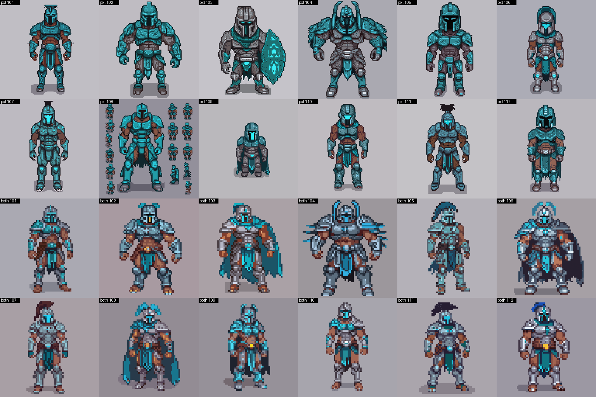
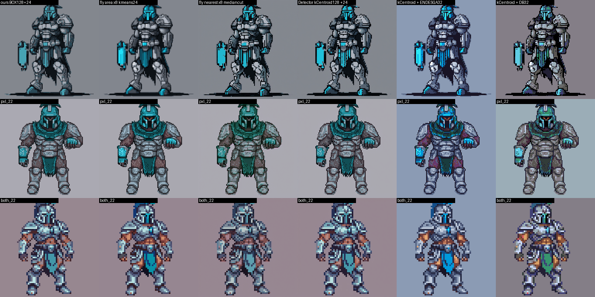
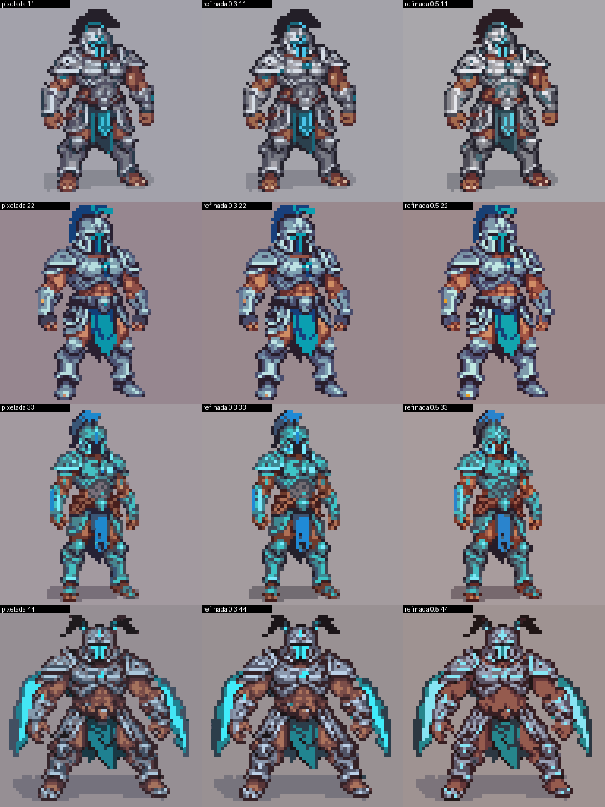

# Experimentos de geração de pixel art (novembro de 2026)

Registro do que foi testado para escolher o motor de IA do OpenPixel AI Studio, com resultados e limitações. Ambiente: Windows 11, RTX 5050 (8 GB), ComfyUI Desktop 0.45, SDXL base 1.0.

Metodologia comum: prompt de um guerreiro de armadura sem armas ("mãos vazias"), seeds fixas, 1024 px, 25 passos, CFG 6,5, depois pixelização em grade de 128 px com 24 cores. Avaliação **visual e qualitativa**, em amostras pequenas (4 a 16 imagens por configuração); não há métrica automática confiável.

## 1. LoRAs próprias (descartadas)

Foram treinadas 3 LoRAs de SDXL (rank 16, 1.500 passos, ≈ 3,3 h cada) com 3.462 imagens. Resultado negativo: desorganizadas (folhas de sprite, fragmentos) e inferiores às alternativas públicas. Houve ainda um erro de integração: o ComfyUI ignorava as LoRAs por causa do formato das chaves (12.320 avisos `lora key not loaded`), então as primeiras comparações no Comfy eram, na verdade, do SDXL base. Os pesos e o relatório completo ficam arquivados **fora do repositório**.

**Lições:** (1) confira o log do ComfyUI por `lora key not loaded`; (2) compare **pixels decodificados**, nunca o hash do arquivo PNG do Comfy (ele embute o workflow nos metadados); (3) mudar `strength_clip` junto com `strength_model` não é o problema, e sim a LoRA não carregada.

## 2. LoRAs públicas de SDXL

| Configuração | Resultado |
|---|---|
| SDXL base ("pixel art" no prompt) | Composição solta, sem grade de pixels; algumas imagens com duas vistas. |
| `pixel-art-xl-v1.1` (1,0) | Pixel art limpo e consistente, proporções *chibi*; 2 de 16 seeds com arma/escudo. |
| `PixelArtRedmond-Lite64` (1,0) | Pixel mais grosso e ruidoso, tons de pele, perde cores do prompt. |
| **Ambas empilhadas (0,7 + 0,7)** | **Melhor equilíbrio:** proporções heroicas, detalhe rico, **0 de 16 seeds com arma**. |

*Linhas 1–2: `pixel-art-xl`; linhas 3–4: as duas empilhadas. Seeds 101–112.*

Limitação: 16 amostras por configuração; "sem arma" foi contado visualmente. Prompt negativo com pesos e poses de "mãos vazias" não eliminaram armas no modelo base ou na LoRA própria; a pilha das duas LoRAs públicas foi o que resolveu nas amostras.

## 3. Pixelização e paleta

Comparados: o pipeline existente (`postprocess.pixelize`: PixelOE + K-Means CIELAB), o módulo `pixelate.py` (redução por média + paleta K-Means), o pixelador do repositório *flycarl/ComfyUI-Pixelate* e os algoritmos do *dimtoneff/ComfyUI-PixelArt-Detector* (k-centroid e paletas fixas).

- Os métodos de **redução** dão resultados parecidos; o k-centroid é um pouco mais nítido.
- A **paleta** é o que muda: K-Means preserva cores de destaque (laranja, ciano) que o median-cut puro perde. O `pixelate.py` usa median-cut refinado por K-Means.
- **Paletas fixas** (Endesga 32, DawnBringer 32) padronizam o visual, mas trocam as cores do personagem. Úteis quando o jogo exige uma paleta única.
- `postprocess.pixelize` (PixelOE) ficou comparável, mas perdeu detalhe de elmo em 2 de 4 imagens; `pixelate.py` manteve mais detalhe.

*Colunas: média+median-cut, flycarl (área, K-Means), flycarl (nearest), k-centroid, k-centroid + Endesga 32, k-centroid + DawnBringer 32.*

Os dois repositórios de nós foram **revisados e testados fora do ComfyUI** (não foram instalados no Comfy). Motivo: o `__init__.py` do *PixelArt-Detector* baixa e instala, via `pip`, uma *wheel* binária de um fork pessoal (`dimtoneff/pyclustering`) quando falta o `pyclustering`; usamos o pacote oficial do PyPI. O *flycarl/ComfyUI-Pixelate* não declara licença, então **o código não foi copiado**; apenas a ideia (K-Means para a paleta).

## 4. Refino por img2img

Passar a imagem já pixelada de volta pelo SDXL com as duas LoRAs (denoise 0,3 e 0,5) e pixelizar de novo mudou muito pouco e custa ≈ 20 s por imagem. Não compensa.

## 5. Não testados (e por quê)

| Recurso | Situação |
|---|---|
| LoRA de animação *Pixel Art Animation (Birdman)* | É para **Wan 2.1 I2V 14B (480p)**. Exigiria baixar o modelo base (≈ 15–30 GB conforme a quantização), o codificador de texto e o VAE do Wan, e rodaria muito lento em 8 GB de VRAM. Viável em teoria com versões quantizadas (GGUF), ainda não tentado. |
| *LuisaP MOSS Pixel Art Refiner* | Não há versão SDXL (as versões são MOSS Image, Z-Image, Qwen e SD 1.5). A versão SD 1.5 tem 1 MB e exigiria um checkpoint SD 1.5 (≈ 2–4 GB). |
| *PixelArtRedmond* nas bases Qwen, Z-Image e Flux | Exigem os respectivos modelos base; usamos a versão **SDXL (Lite 64)**. |

## 6. Recomendação atual

SDXL base + `pixel-art-xl-v1.1` (0,7) + `PixelArtRedmond-Lite64` (0,7), via ComfyUI, seguido do pós-processamento do `service` (ou de `pixelate.py`, com paleta K-Means ou fixa). Próximos passos: controle de pose, inpainting para remover objetos e, depois, animação.
